<div align="center">



<br/>

<a href="../../releases/latest">
  
</a>

<sub><b>Windows • Free • No Python needed</b></sub>

<br/><br/>

[✨ Features](#-features) &nbsp;•&nbsp; [⬇️ Install](#%EF%B8%8F-download--install) &nbsp;•&nbsp; [🗣️ Commands](#%EF%B8%8F-try-saying) &nbsp;•&nbsp; [⚙️ AI Setup](#%EF%B8%8F-optional-enable-ai-features) &nbsp;•&nbsp; [❓ FAQ](#-faq)

</div>

<!-- 📸 ADD YOUR REAL HUD SCREENSHOT / GIF HERE (most important part!)
<div align="center"></div>
-->


## 👋 What is JARVIS?

**JARVIS** is a voice-controlled desktop assistant with a glowing sci-fi **arc-reactor HUD**.

Just talk to it like a friend. It opens your apps, checks your PC, tests your internet, sets reminders, takes notes, answers questions, keeps an eye on phishing links and scam messages, and even cheers you up. It talks back in a natural voice, and the text on screen stays in sync with the speech.

> **Download → Extract → Double-click → Talk.** &nbsp; That's the whole setup.

<div align="center">

| 🎙️ **Hands-free** | ⚡ **Fast** | 🧠 **Friendly** | 🛡️ **Protective** |
|:---:|:---:|:---:|:---:|
| Just start talking, no button needed | Runs right on your PC | Talks like a human, not a robot | Flags phishing links and scam messages |

</div>

### 🔄 How it works

<div align="center">

| **1️⃣ &nbsp;SAY** | ➜ | **2️⃣ &nbsp;THINK** | ➜ | **3️⃣ &nbsp;ACT & REPLY** |
|:---:|:---:|:---:|:---:|:---:|
| *"Jarvis, open YouTube"* | | JARVIS understands you | | Does it, and answers in voice + on screen |

</div>


## ⬇️ Download & Install

### 🚀 Quick Start

| Step | What to do |
|:---:|---|
| **1** | 📥 Download the latest **`JARVIS-windows-vX.Y.zip`** from [Releases](../../releases/latest) |
| **2** | 📁 Extract it anywhere, for example `C:\Jarvis\` — keep the files together |
| **3** | 🖱️ Double-click **`Jarvis.exe`** inside the extracted `JARVIS` folder |
| **4** | 🎤 Allow microphone access when Windows asks |
| **5** | 🗣️ Say **"Jarvis, hello"** and enjoy! |

Your folder should look like this (don't separate the files — `Jarvis.exe` needs everything next to it):

```
📁 JARVIS
 ├── 📄 Jarvis.exe
 ├── 📁 _internal
 └── 📄 jarvis_config.example.json   (copy → jarvis_config.json to unlock optional AI features)
```

> 💡 **Windows SmartScreen warning?** Click **More info → Run anyway**. This appears for any new app that is not digitally signed.

> 🔄 **Updates are automatic.** When a new version is out, a glowing **⬆ UPDATE** button appears next to the tabs and JARVIS tells you out loud. One click downloads, verifies and installs it, and your settings and memory are kept.


## ✨ Features

<table>
<tr>
<td width="50%" valign="top">

### 🎙️ Natural Voice Control
- Always listening, no button needed (optional wake word: **"Jarvis"**, even catches mis-hearings)
- Adjustable mic sensitivity + **far-field mode** for across the room
- Switchable recognition accent (try Indian English for a South Asian accent)
- Natural British voice, with an instant offline voice as backup

### 💻 Control Your PC
- Open any installed app, website, or settings page
- Volume, brightness, media keys
- Minimize all / switch windows
- Screenshots, empty recycle bin
- Lock / sleep / shutdown / restart, **always asks "yes" first**

### 🧠 Smart Conversation
- Warm, human-like replies that react to your mood and good news
- Exact factual answers with **no API key** (capitals, founders, definitions, unit and currency conversion)
- Open-ended research from Google, DuckDuckGo, Bing & Wikipedia — written in its own words with a free AI key
- Remembers things you tell it, and answers you teach it

</td>
<td width="50%" valign="top">

### 📊 System Monitor
- CPU, RAM, GPU, storage, battery, uptime
- See which apps are eating resources
- Full PC specs on request

### 🌐 Network Toolkit
- Internet **speed test**, ping any host
- Local & public IP, Wi-Fi info
- **"Who's on my Wi-Fi?"** LAN scan
- Open ports, data usage
- Live spoken alerts when the internet drops or comes back

### 🛡️ NEW in v3.3 — Security & More
- **Phishing & scam detection**: checks links against known threat lists, catches look-alike brand names, and scans suspicious SMS/email text for scam patterns
- **PC security check**: antivirus, firewall, open ports, Wi-Fi security and more, with a score and fixes
- Password strength + breach check, CVE lookup, hashing tools
- **Reminders** ("remind me to call Rahim at 5pm")
- **Live news**, by topic or country
- Reads and explains text on your screen, only when you ask
- WhatsApp messages & calls, phone calls via Phone Link or ADB
- Builds small scripts, tools and websites for you *(needs a free AI key)*
- Copy / paste by voice

</td>
</tr>
</table>

### 🎨 Sci-Fi HUD

A glowing cyan **arc-reactor interface** that comes alive while JARVIS listens, thinks and speaks — with dedicated tabs for System, Network, Apps, Control, Memory, Reminders, News, Security and Settings.


## 🗣️ Try Saying

<table>
<tr>
<td width="50%" valign="top">

**💻 Your PC**
```text
"Jarvis, open YouTube"
"Jarvis, open Chrome in incognito"
"Jarvis, set volume to 40"
"Jarvis, take a screenshot"
"Jarvis, how much RAM do I have?"
"Jarvis, which apps are using my CPU?"
```

**🛡️ Security (NEW)**
```text
"Jarvis, run a security check"
"Jarvis, is this link safe? paypal-login.xyz"
"Jarvis, check this message for scams"
"Jarvis, generate a strong password"
"Jarvis, remind me to renew my passport tomorrow at 9am"
```

</td>
<td width="50%" valign="top">

**🌐 Network & Extras**
```text
"Jarvis, run a speed test"
"Jarvis, who is on my Wi-Fi?"
"Jarvis, what's my IP address?"
"Jarvis, what is the capital of Japan?"
"Jarvis, convert 10 miles to kilometers"
"Jarvis, tell me the tech news"
```

**📱 WhatsApp & Fun (NEW)**
```text
"Jarvis, send Rahim a WhatsApp saying I'm on my way"
"Jarvis, call Rahim on WhatsApp"
"Jarvis, build me a simple to-do list website"
"Jarvis, copy that"
```

</td>
</tr>
</table>

> 💬 You can also just chat: *"I'm bored"*, *"How are you?"*, *"I passed my exam!"*, *"welcome me"*


## ⚙️ Optional: Enable AI Features

**JARVIS works fully without any key** — voice control, PC control, network tools, security checks, reminders, and even factual answers (capitals, dates, definitions, conversions) all work out of the box.

Adding a **free** AI key unlocks two extra things: open-ended answers written in JARVIS's own words (instead of a merged summary of sources), and the **code/website builder**.

Create a file named **`jarvis_config.json`** next to `Jarvis.exe` (copy `jarvis_config.example.json` and rename it):

```json
{
  "llm": {
    "api_key": "YOUR_FREE_API_KEY_HERE",
    "base_url": "https://api.groq.com/openai/v1",
    "model": "llama-3.3-70b-versatile"
  }
}
```

Get a free key at [console.groq.com](https://console.groq.com) — no card required.

> 🔒 **Never share your API key** or upload this file to GitHub. It's already excluded by `.gitignore`.

<details>
<summary><b>🔧 Add your own websites, apps, and more (click to expand)</b></summary>

<br/>

```json
{
  "sites": { "my blog": "https://example.com" },
  "apps":  { "my editor": "C:\\Path\\To\\App.exe" },
  "country_code": "880",
  "google": { "api_key": "YOUR_GOOGLE_API_KEY", "cx": "YOUR_SEARCH_ENGINE_ID" },
  "virustotal": { "api_key": "YOUR_FREE_VIRUSTOTAL_KEY" }
}
```

Then just say *"Jarvis, open my blog"*. `country_code` is used for WhatsApp numbers you save without a country code. `google` and `virustotal` are optional extra accuracy for web search and link scanning — see the [full manual](MANUAL.md) for details.

</details>


## 💻 System Requirements

| | |
|---|---|
| 🪟 **OS** | Windows 10 / 11 (64-bit) |
| 🎤 **Microphone** | Any working mic |
| 🌐 **Internet** | Needed for speech recognition, the natural voice, and web-based answers |
| 🐍 **Python** | ❌ Not needed |


## ❓ FAQ

<details>
<summary><b>The app won't open / shows a missing file error</b></summary>

<br/>

Make sure `Jarvis.exe` and the `_internal` folder are in the **same folder**. Never move the exe out on its own — extract the whole ZIP as one piece.

</details>

<details>
<summary><b>JARVIS can't hear me</b></summary>

<br/>

Check your Windows microphone permissions and default input device, and watch the live level meter in **Settings → Microphone**. Then try saying *"I am far away"* for far-field mode, or raise the sensitivity there.

</details>

<details>
<summary><b>Do I need an API key?</b></summary>

<br/>

No. JARVIS works fully without one. A free key only adds AI-written answers in its own words and the code/website builder — see [AI Setup](#%EF%B8%8F-optional-enable-ai-features).

</details>

<details>
<summary><b>Is my data private?</b></summary>

<br/>

Your memory, notes and reminders stay on your PC. Voice goes to Google's speech service to be understood, replies go through Microsoft's voice service to be spoken, and questions go to search engines to be answered — that's how any voice assistant works. Nothing is sent anywhere else, and there's no analytics or tracking of JARVIS's own. Full details are in the [manual](MANUAL.md#privacy).

</details>

<details>
<summary><b>Windows Defender / SmartScreen blocks it</b></summary>

<br/>

Click **More info → Run anyway**. The app is not code-signed yet, so Windows is cautious with new programs.

</details>

<details>
<summary><b>The security check or WhatsApp calling isn't working</b></summary>

<br/>

The full security audit reads more when JARVIS runs as administrator. WhatsApp calling needs either WhatsApp Desktop installed or ADB set up — see the [manual](MANUAL.md) for setup steps.

</details>

<details>
<summary><b>Does it work on Mac or Linux?</b></summary>

<br/>

Not yet. JARVIS is Windows only for now.

</details>


## 📖 Full Manual

This README covers the basics. For the complete command list, every feature explained, and troubleshooting, see **[MANUAL.md](MANUAL.md)**.

## 💬 Feedback & Support

Found a bug or have a feature idea? Open an [Issue](../../issues) and tell me. I read every one!

If you enjoy JARVIS, please **⭐ star this repo**. It really helps!

## 📜 License

JARVIS is **free to use** for personal use. The source code is **not public**, and redistribution, modification or reselling of the app is not allowed without permission.

© 2026 Abu Tanim. All rights reserved.

<div align="center">

<br/>

**Made with ❤️ by [Mr. Tan](https://github.com/Mr74nX)**

*"Sometimes you gotta run before you can walk."*


</div>
